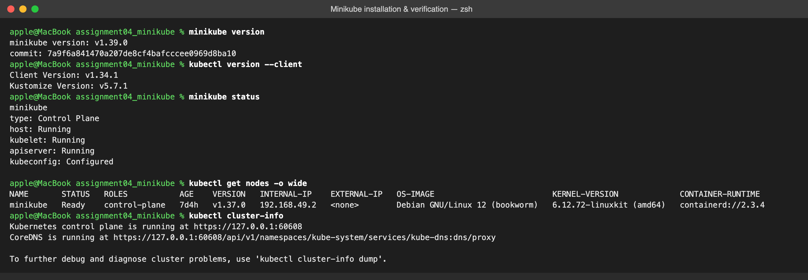
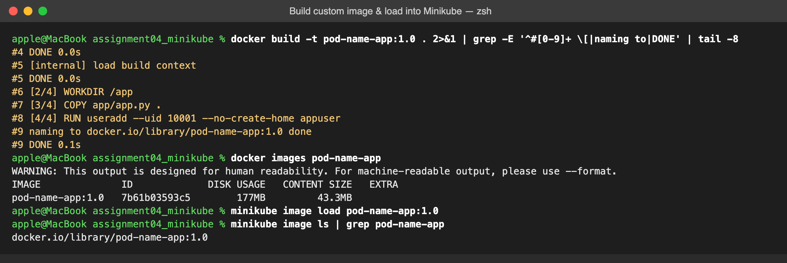
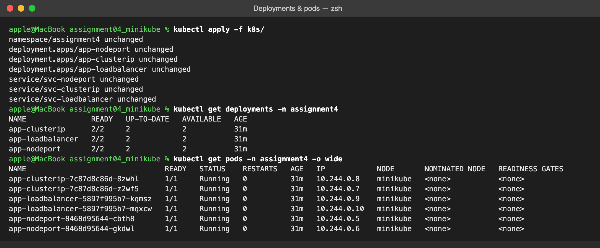
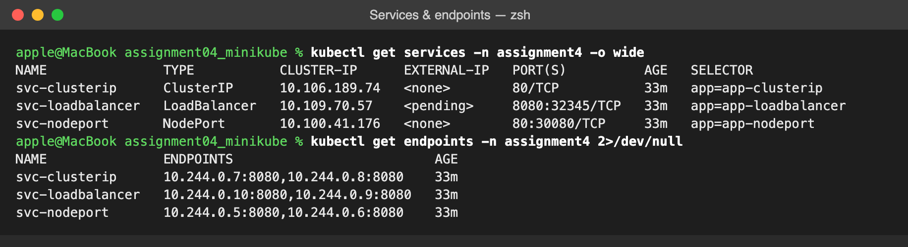
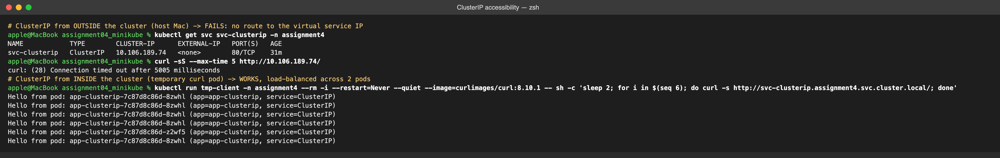
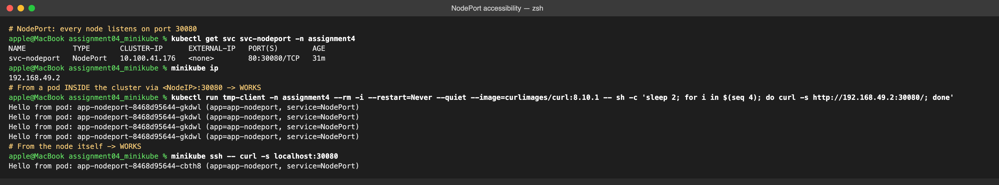
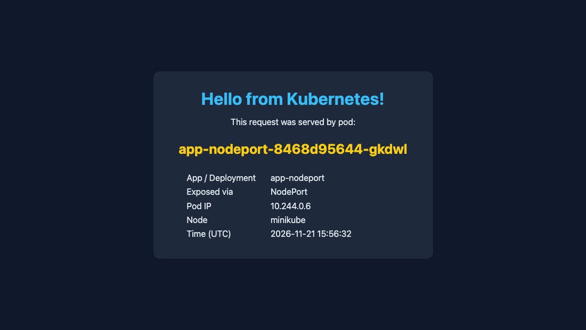
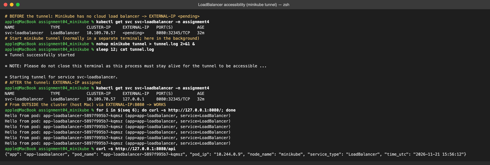
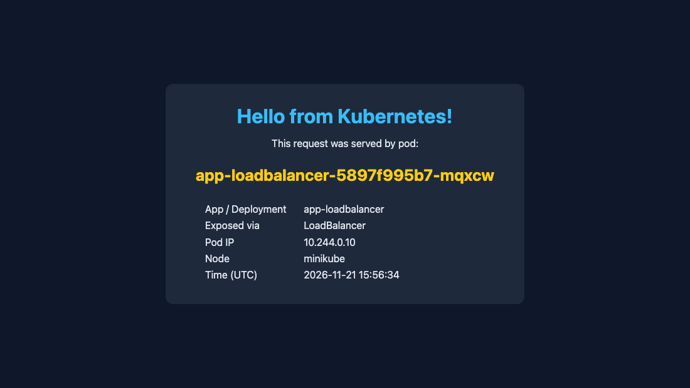
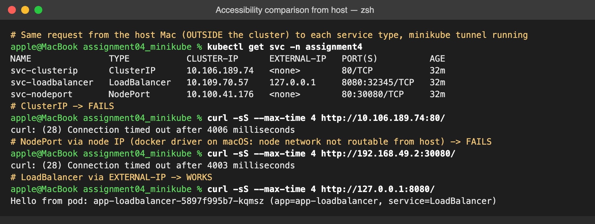

# Assignment 04 – Minikube: Deployments & Service Types

This project sets up a local Kubernetes cluster with **Minikube**, builds a **custom Docker image** of a small web app that **displays the name of the pod** serving each request, deploys it as **three Deployments**, and exposes each one with a different **Service type**:

| Deployment         | Service            | Type           | Reachable from                                              |
|--------------------|--------------------|----------------|-------------------------------------------------------------|
| `app-nodeport`     | `svc-nodeport`     | `NodePort`     | Inside the cluster + any machine that can reach a node IP on port `30080` |
| `app-clusterip`    | `svc-clusterip`    | `ClusterIP`    | **Only inside the cluster**                                 |
| `app-loadbalancer` | `svc-loadbalancer` | `LoadBalancer` | **Outside the cluster** through an `EXTERNAL-IP` (`minikube tunnel`) |

All outputs below are real outputs captured while running this project (also saved in [`outputs/`](outputs/)).

---

## Table of Contents
1. [Repository structure](#1-repository-structure)
2. [Prerequisites & Minikube installation](#2-prerequisites--minikube-installation)
3. [Start and verify the Minikube cluster](#3-start-and-verify-the-minikube-cluster)
4. [Build the custom Docker image](#4-build-the-custom-docker-image)
5. [Deploy the applications](#5-deploy-the-applications)
6. [Set up and verify the Services](#6-set-up-and-verify-the-services)
7. [Accessibility demonstration](#7-accessibility-demonstration)
8. [Manifest configuration explained](#8-manifest-configuration-explained)
9. [Cleanup](#9-cleanup)
10. [Troubleshooting](#10-troubleshooting)
11. [References](#11-references)

---

## 1. Repository structure

```
.
├── app/
│   └── app.py                       # Python (stdlib only) web app that prints the pod name
├── Dockerfile                       # Builds the custom image pod-name-app:1.0
├── .dockerignore
├── k8s/
│   ├── 00-namespace.yaml            # Namespace "assignment4"
│   ├── 01-deployment-nodeport.yaml  # Deployment #1 (2 replicas)
│   ├── 02-deployment-clusterip.yaml # Deployment #2 (2 replicas)
│   ├── 03-deployment-loadbalancer.yaml # Deployment #3 (2 replicas)
│   ├── 11-service-nodeport.yaml     # NodePort service     -> Deployment #1
│   ├── 12-service-clusterip.yaml    # ClusterIP service    -> Deployment #2
│   └── 13-service-loadbalancer.yaml # LoadBalancer service -> Deployment #3
├── outputs/                         # Captured terminal output of every verification step
├── screenshots/                     # Screenshots of every step (embedded below)
└── README.md
```

### The application
`app/app.py` is a tiny HTTP server (Python standard library only, no dependencies) listening on port **8080**:

| Path       | Response                                                                         |
|------------|----------------------------------------------------------------------------------|
| `/`        | HTML page in a browser; one line `Hello from pod: <pod-name> ...` for `curl`      |
| `/api`     | JSON with `pod_name`, `pod_ip`, `node_name`, `app`, `service_type`, `time_utc`    |
| `/healthz` | `ok` – used by the Kubernetes readiness/liveness probes and Docker `HEALTHCHECK` |

The pod name is injected by Kubernetes through the **Downward API** (`fieldRef: metadata.name`) as the env variable `POD_NAME`. Because each Deployment runs **2 replicas**, repeated requests show different pod names, which also demonstrates that a Service load-balances across its pods.

---

## 2. Prerequisites & Minikube installation

Tested on macOS (Intel, x86_64) with:

| Tool           | Version used | Purpose |
|----------------|--------------|---------|
| Docker Desktop | 29.2.1       | Builds the image and is the **Minikube driver** (the cluster runs inside a Docker container, so no VirtualBox needed) |
| Minikube       | v1.39.0      | Local single-node Kubernetes cluster |
| kubectl        | v1.34.1      | Kubernetes command-line client |

### a. Virtualization platform
Docker Desktop is used as the virtualization layer (allowed by the assignment). Install it from <https://www.docker.com/products/docker-desktop/> and make sure it is running:
```bash
docker info --format '{{.ServerVersion}}'    # prints the Docker engine version if running
```
> Alternative: VirtualBox can be used instead with `minikube start --driver=virtualbox`.

### b. Install Minikube and kubectl
Following the official guide (<https://minikube.sigs.k8s.io/docs/start/>):

```bash
# macOS (Homebrew)
brew install minikube kubectl

# macOS (binary, Intel) – alternative
curl -LO https://storage.googleapis.com/minikube/releases/latest/minikube-darwin-amd64
sudo install minikube-darwin-amd64 /usr/local/bin/minikube

# Linux (x86_64)
curl -LO https://storage.googleapis.com/minikube/releases/latest/minikube-linux-amd64
sudo install minikube-linux-amd64 /usr/local/bin/minikube

# Windows (PowerShell, with winget)
winget install Kubernetes.minikube
```

### c. Verify the installation
```bash
minikube version
kubectl version --client
```
Expected output:
```
minikube version: v1.39.0
commit: 7a9f6a841470a207de8cf4bafcccee0969d8ba10

Client Version: v1.34.1
Kustomize Version: v5.7.1
```

---

## 3. Start and verify the Minikube cluster

```bash
minikube start --driver=docker
```
| Part              | Meaning |
|-------------------|---------|
| `minikube start`  | Creates (or restarts) a local single-node Kubernetes cluster and points `kubectl` at it |
| `--driver=docker` | Runs the Kubernetes node as a Docker container instead of a VM |

Useful optional flags: `--cpus=2 --memory=4096` (resources), `--kubernetes-version=v1.37.0` (pin a version).

Verify:
```bash
minikube status          # host, kubelet and apiserver must be "Running"
kubectl get nodes -o wide
kubectl cluster-info
```
Expected output:
```
minikube
type: Control Plane
host: Running
kubelet: Running
apiserver: Running
kubeconfig: Configured

NAME       STATUS   ROLES           AGE   VERSION   INTERNAL-IP    ...  CONTAINER-RUNTIME
minikube   Ready    control-plane   ...   v1.37.0   192.168.49.2   ...  containerd://2.3.4

Kubernetes control plane is running at https://127.0.0.1:60608
CoreDNS is running at https://127.0.0.1:60608/api/v1/namespaces/kube-system/services/kube-dns:dns/proxy
```




---

## 4. Build the custom Docker image

```bash
# 1. Build the image on the host
docker build -t pod-name-app:1.0 .

# 2. (optional) Quick local test before Kubernetes
docker run -d --name podtest -p 18080:8080 pod-name-app:1.0
curl localhost:18080/          # -> Hello from pod: <container-id> (app=pod-name-app, service=unknown)
docker rm -f podtest

# 3. Copy the image into Minikube's container runtime
minikube image load pod-name-app:1.0
minikube image ls | grep pod-name-app     # -> docker.io/library/pod-name-app:1.0
```




**Why `minikube image load`?** Minikube runs its own container runtime (containerd) inside the node, which cannot see images built by Docker Desktop on the host. `image load` copies the image in, so no registry (Docker Hub) is needed.

**Why tag `1.0` and not `latest`?** With the `:latest` tag Kubernetes defaults to `imagePullPolicy: Always` and would try to download the image from Docker Hub, which fails for a local-only image. The manifests also set `imagePullPolicy: Never`.

Dockerfile highlights:
- `FROM python:3.12-slim`: small official base image.
- Runs as **non-root** user `10001` (security best practice).
- `EXPOSE 8080` + `HEALTHCHECK` on `/healthz`.

---

## 5. Deploy the applications

```bash
# Validate all manifests against the API server without creating anything
kubectl apply -f k8s/00-namespace.yaml
kubectl apply --dry-run=server -f k8s/

# Create the namespace, 3 deployments and 3 services (applied in file-name order)
kubectl apply -f k8s/

# Wait until every deployment is ready
kubectl -n assignment4 rollout status deploy/app-nodeport
kubectl -n assignment4 rollout status deploy/app-clusterip
kubectl -n assignment4 rollout status deploy/app-loadbalancer
```
Output:
```
namespace/assignment4 unchanged
deployment.apps/app-nodeport created
deployment.apps/app-clusterip created
deployment.apps/app-loadbalancer created
service/svc-nodeport created
service/svc-clusterip created
service/svc-loadbalancer created
deployment "app-nodeport" successfully rolled out
deployment "app-clusterip" successfully rolled out
deployment "app-loadbalancer" successfully rolled out
```

### Verify the pods
```bash
kubectl get deployments -n assignment4
kubectl get pods -n assignment4 -o wide
```
Expected outcome: **3 deployments with `READY 2/2`** and **6 pods in `Running` state**:
```
NAME               READY   UP-TO-DATE   AVAILABLE   AGE
app-clusterip      2/2     2            2           9s
app-loadbalancer   2/2     2            2           9s
app-nodeport       2/2     2            2           9s

NAME                                READY   STATUS    RESTARTS   AGE   IP            NODE
app-clusterip-7c87d8c86d-8zwhl      1/1     Running   0          9s    10.244.0.8    minikube
app-clusterip-7c87d8c86d-z2wf5      1/1     Running   0          9s    10.244.0.7    minikube
app-loadbalancer-5897f995b7-kqmsz   1/1     Running   0          8s    10.244.0.9    minikube
app-loadbalancer-5897f995b7-mqxcw   1/1     Running   0          8s    10.244.0.10   minikube
app-nodeport-8468d95644-cbth8       1/1     Running   0          9s    10.244.0.5    minikube
app-nodeport-8468d95644-gkdwl       1/1     Running   0          9s    10.244.0.6    minikube
```



Pod names follow `<deployment>-<replicaset-hash>-<random>`; the `10.244.0.x` IPs are pod-network addresses, only valid inside the cluster.

---

## 6. Set up and verify the Services

The services were created by `kubectl apply -f k8s/` above (files `11-`, `12-`, `13-`). They can also be applied one by one:
```bash
kubectl apply -f k8s/11-service-nodeport.yaml      # a. NodePort     -> Deployment 1
kubectl apply -f k8s/12-service-clusterip.yaml     # b. ClusterIP    -> Deployment 2
kubectl apply -f k8s/13-service-loadbalancer.yaml  # c. LoadBalancer -> Deployment 3
```

### d. Verify
```bash
kubectl get services -n assignment4 -o wide
kubectl get endpoints -n assignment4
```
Output:
```
NAME               TYPE           CLUSTER-IP      EXTERNAL-IP   PORT(S)          AGE   SELECTOR
svc-clusterip      ClusterIP      10.106.189.74   <none>        80/TCP           14s   app=app-clusterip
svc-loadbalancer   LoadBalancer   10.109.70.57    <pending>     8080:32345/TCP   14s   app=app-loadbalancer
svc-nodeport       NodePort       10.100.41.176   <none>        80:30080/TCP     14s   app=app-nodeport

NAME               ENDPOINTS                          AGE
svc-clusterip      10.244.0.7:8080,10.244.0.8:8080    14s
svc-loadbalancer   10.244.0.10:8080,10.244.0.9:8080   14s
svc-nodeport       10.244.0.5:8080,10.244.0.6:8080    14s
```



How to read it:
- Every service gets a **CLUSTER-IP** (internal virtual IP), even NodePort and LoadBalancer: the types build on each other (**ClusterIP ⊂ NodePort ⊂ LoadBalancer**).
- `80:30080/TCP`: the NodePort service listens on port 80 of its ClusterIP and on port **30080 of every node**.
- `8080:32345/TCP`: the LoadBalancer automatically got a NodePort (32345) as well.
- `EXTERNAL-IP <pending>`: Minikube has no cloud provider to create a real load balancer, so the IP stays pending until `minikube tunnel` runs (section 7c).
- **ENDPOINTS** lists the 2 pod IPs behind each service, which proves the label `selector` matches the pods.

---

## 7. Accessibility demonstration

### a. ClusterIP: why pods are NOT accessible from outside the cluster

**Explanation.** A `ClusterIP` is a **virtual IP** taken from the cluster's internal service range (`10.96.0.0/12` in Minikube). It is not assigned to any network interface; it exists only as forwarding rules (iptables/IPVS) that **kube-proxy** programs on each cluster node. Those rules translate `ClusterIP:80` to a pod `IP:8080`. A computer outside the cluster:
1. has **no route** to the `10.96.0.0/12` (services) or `10.244.0.0/16` (pods) networks, and
2. does not run kube-proxy, so even a packet that arrived would not be translated.

The service is also not published on any node port or external IP. That makes ClusterIP the right choice for **internal back-ends** (databases, internal APIs) that should never be exposed directly. Inside the cluster, **CoreDNS** resolves the name `svc-clusterip.assignment4.svc.cluster.local` to the ClusterIP.

**Demonstration.**
```bash
# 1) From the host (outside the cluster)
curl --max-time 5 http://10.106.189.74/

# 2) From a temporary pod inside the cluster
kubectl run tmp-client -n assignment4 --rm -i --restart=Never --image=curlimages/curl:8.10.1 -- \
  sh -c 'for i in $(seq 6); do curl -s http://svc-clusterip.assignment4.svc.cluster.local/; done'
```
`kubectl run ... --rm -i --restart=Never` starts a one-off pod, attaches to its output and deletes it when done.

Output ([`outputs/03-clusterip-demo.txt`](outputs/03-clusterip-demo.txt)):
```
### 1) From OUTSIDE the cluster (the host Mac) -> FAILS
$ curl --max-time 5 http://10.106.189.74/
curl: (28) Connection timed out after 5006 milliseconds

### 2) From INSIDE the cluster (a temporary curl pod) -> WORKS
--- by DNS name svc-clusterip.assignment4.svc.cluster.local:
Hello from pod: app-clusterip-7c87d8c86d-8zwhl (app=app-clusterip, service=ClusterIP)
Hello from pod: app-clusterip-7c87d8c86d-z2wf5 (app=app-clusterip, service=ClusterIP)
Hello from pod: app-clusterip-7c87d8c86d-z2wf5 (app=app-clusterip, service=ClusterIP)
Hello from pod: app-clusterip-7c87d8c86d-8zwhl (app=app-clusterip, service=ClusterIP)
Hello from pod: app-clusterip-7c87d8c86d-z2wf5 (app=app-clusterip, service=ClusterIP)
Hello from pod: app-clusterip-7c87d8c86d-8zwhl (app=app-clusterip, service=ClusterIP)
--- by ClusterIP 10.106.189.74:
Hello from pod: app-clusterip-7c87d8c86d-z2wf5 (app=app-clusterip, service=ClusterIP)
```
✅ Expected outcome: timeout from outside; inside the cluster, both pods (`8zwhl`, `z2wf5`) answer.




### b. NodePort: pods accessible through `<NodeIP>:30080`

A NodePort service opens the same static port (here **30080**, range 30000–32767) on **every node**. Any client that can reach a node's IP can reach the pods, while the service is still reachable inside the cluster through its ClusterIP.

```bash
minikube ip                                   # -> 192.168.49.2  (the node's IP)

# 1) Inside the cluster: a pod calls NodeIP:30080
kubectl run tmp-client -n assignment4 --rm -i --restart=Never --image=curlimages/curl:8.10.1 -- \
  sh -c 'for i in $(seq 4); do curl -s http://192.168.49.2:30080/; done'

# 2) On the node itself
minikube ssh -- curl -s localhost:30080

# 3) From the host: open a tunnel to the NodePort (needed with the Docker driver on macOS/Windows)
minikube service svc-nodeport -n assignment4 --url    # prints http://127.0.0.1:<port>, keep it running
curl http://127.0.0.1:<port>/
```
Output ([`outputs/04-nodeport-demo.txt`](outputs/04-nodeport-demo.txt)):
```
### 1) Inside the cluster: a pod calls <NodeIP>:30080 -> WORKS
Hello from pod: app-nodeport-8468d95644-cbth8 (app=app-nodeport, service=NodePort)
Hello from pod: app-nodeport-8468d95644-cbth8 (app=app-nodeport, service=NodePort)
Hello from pod: app-nodeport-8468d95644-gkdwl (app=app-nodeport, service=NodePort)
Hello from pod: app-nodeport-8468d95644-gkdwl (app=app-nodeport, service=NodePort)
--- also reachable inside via its ClusterIP/DNS like any service:
Hello from pod: app-nodeport-8468d95644-cbth8 (app=app-nodeport, service=NodePort)

### 2) On the node itself (minikube ssh) -> WORKS
Hello from pod: app-nodeport-8468d95644-gkdwl (app=app-nodeport, service=NodePort)

### 3) From the host Mac directly to <NodeIP>:30080 (docker driver on macOS) -> times out
curl: (28) Connection timed out after 5003 milliseconds

### 4) From the host Mac through minikube's NodePort tunnel -> WORKS
$ minikube service svc-nodeport -n assignment4 --url
http://127.0.0.1:60718
Hello from pod: app-nodeport-8468d95644-gkdwl (app=app-nodeport, service=NodePort)
```


NodePort app opened in a browser on the host through `minikube service svc-nodeport -n assignment4 --url`:



> **Note on the Docker driver (macOS/Windows):** the node IP `192.168.49.2` lives inside Docker Desktop's private VM network, which the host cannot route to. That is why step 3 times out and `minikube service --url` is used to forward a localhost port to the NodePort. On **Linux**, or with a VM driver such as **VirtualBox**, `curl http://$(minikube ip):30080` works directly from the host. In a real cluster, NodePort makes pods reachable to any machine that can reach a node's IP.

### c. LoadBalancer: pods accessible from outside the cluster

On a cloud provider, a `LoadBalancer` service makes the cloud create an external load balancer with a public IP. Minikube emulates this with **`minikube tunnel`**, which assigns an `EXTERNAL-IP` and routes host traffic into the cluster.

```bash
kubectl get svc svc-loadbalancer -n assignment4     # EXTERNAL-IP: <pending>

# In a SEPARATE terminal, keep it running:
minikube tunnel

kubectl get svc svc-loadbalancer -n assignment4     # EXTERNAL-IP: 127.0.0.1
curl http://127.0.0.1:8080/                         # or open it in a browser
curl http://127.0.0.1:8080/api
```
Output ([`outputs/05-loadbalancer-demo.txt`](outputs/05-loadbalancer-demo.txt)):
```
### 1) BEFORE minikube tunnel: no external IP yet
NAME               TYPE           CLUSTER-IP     EXTERNAL-IP   PORT(S)          AGE
svc-loadbalancer   LoadBalancer   10.109.70.57   <pending>     8080:32345/TCP   101s

### 2) Start the tunnel
$ minikube tunnel
* Tunnel successfully started
* Starting tunnel for service svc-loadbalancer.

### 3) AFTER minikube tunnel: EXTERNAL-IP is assigned
NAME               TYPE           CLUSTER-IP     EXTERNAL-IP   PORT(S)          AGE
svc-loadbalancer   LoadBalancer   10.109.70.57   127.0.0.1     8080:32345/TCP   105s

### 4) From OUTSIDE the cluster (host Mac) via EXTERNAL-IP -> WORKS
Hello from pod: app-loadbalancer-5897f995b7-mqxcw (app=app-loadbalancer, service=LoadBalancer)
Hello from pod: app-loadbalancer-5897f995b7-mqxcw (app=app-loadbalancer, service=LoadBalancer)
Hello from pod: app-loadbalancer-5897f995b7-kqmsz (app=app-loadbalancer, service=LoadBalancer)
Hello from pod: app-loadbalancer-5897f995b7-mqxcw (app=app-loadbalancer, service=LoadBalancer)
Hello from pod: app-loadbalancer-5897f995b7-mqxcw (app=app-loadbalancer, service=LoadBalancer)
Hello from pod: app-loadbalancer-5897f995b7-kqmsz (app=app-loadbalancer, service=LoadBalancer)
$ curl -s http://127.0.0.1:8080/api
{"app": "app-loadbalancer", "pod_name": "app-loadbalancer-5897f995b7-mqxcw", "pod_ip": "10.244.0.10", "node_name": "minikube", "service_type": "LoadBalancer", "time_utc": "2026-11-21 15:25:25"}
```


LoadBalancer app opened in a browser at `http://127.0.0.1:8080` (EXTERNAL-IP):



> The service port is **8080** (not 80) so `minikube tunnel` on macOS does not need `sudo` to bind a privileged port (< 1024).
> With the Docker driver on macOS the external IP is `127.0.0.1`; with other drivers it is a routable IP such as `10.x.x.x`.

### Side-by-side summary (from the host, `minikube tunnel` running)
[`outputs/06-comparison-from-host.txt`](outputs/06-comparison-from-host.txt):
```
ClusterIP     http://10.106.189.74:80            -> FAIL (no route / timeout)
NodePort      http://192.168.49.2:30080          -> FAIL (no route / timeout)
LoadBalancer  http://127.0.0.1:8080              -> OK   Hello from pod: app-loadbalancer-5897f995b7-kqmsz ...
```




| Service type | Inside cluster | Via node IP:port | From outside (external IP) | Typical use |
|--------------|:--------------:|:----------------:|:--------------------------:|-------------|
| ClusterIP    | ✅ | ❌ | ❌ | Internal services (DB, internal APIs) |
| NodePort     | ✅ | ✅ `:30080` | ⚠️ only if the node IP is reachable | Dev/testing, bare-metal, behind own LB |
| LoadBalancer | ✅ | ✅ `:32345` | ✅ `EXTERNAL-IP:8080` | Production public exposure on cloud |

---

## 8. Manifest configuration explained

### Deployment (`k8s/01-03-deployment-*.yaml`)
| Field | Value | Why |
|-------|-------|-----|
| `metadata.namespace` | `assignment4` | Groups all resources; one-command cleanup |
| `spec.replicas` | `2` | Two pods per deployment, which shows load-balancing and gives redundancy |
| `spec.selector.matchLabels` / `template.metadata.labels` | `app: app-<type>` | Links the Deployment to its pods; the Service selects pods with the same label |
| `image` | `pod-name-app:1.0` | The custom image built in section 4 |
| `imagePullPolicy` | `Never` | Use the image loaded into Minikube; never contact a registry |
| `containerPort` | `8080` (named `http`) | Port the app listens on |
| `env[].valueFrom.fieldRef` | `metadata.name`, `status.podIP`, `spec.nodeName` | **Downward API**: injects the pod's own name/IP/node so the app can display them |
| `readinessProbe` | `GET /healthz` every 5s | Pod is added to the Service endpoints only once it is ready |
| `livenessProbe` | `GET /healthz` every 10s | Container is restarted automatically if it hangs |
| `resources.requests/limits` | 50m–200m CPU, 32–128Mi RAM | Fair scheduling and protection of the small local cluster |

### Services (`k8s/11-13-service-*.yaml`)
| Field | NodePort | ClusterIP | LoadBalancer |
|-------|----------|-----------|--------------|
| `spec.type` | `NodePort` | `ClusterIP` (default) | `LoadBalancer` |
| `selector` | `app: app-nodeport` | `app: app-clusterip` | `app: app-loadbalancer` |
| `port` (service port) | `80` | `80` | `8080` |
| `targetPort` (container port) | `8080` | `8080` | `8080` |
| `nodePort` | `30080` (fixed) | – | auto-assigned (`32345`) |

---

## 9. Cleanup
```bash
# stop any running "minikube tunnel" / "minikube service" with Ctrl+C
kubectl delete -f k8s/                 # or: kubectl delete namespace assignment4
minikube stop                          # stop the cluster (keeps its state)
minikube delete                        # (optional) delete the cluster completely
```

---

## 10. Troubleshooting
| Symptom | Cause / Fix |
|---------|-------------|
| Pod status `ErrImageNeverPull` | Image not inside Minikube; run `minikube image load pod-name-app:1.0` |
| `EXTERNAL-IP` stays `<pending>` | `minikube tunnel` is not running; start it in a separate terminal |
| `curl $(minikube ip):30080` times out on macOS/Windows | Docker-driver networking; use `minikube service svc-nodeport -n assignment4 --url` |
| `kubectl run -i` prints only some lines | Output began before kubectl attached; the commands above start with `sleep 2` |
| kubectl version skew warning | Harmless for these commands, or use `minikube kubectl -- <args>` |

---

## 11. References
- Minikube – Get Started: <https://minikube.sigs.k8s.io/docs/start/>
- Minikube – Accessing apps (NodePort & LoadBalancer, `minikube service`, `minikube tunnel`): <https://minikube.sigs.k8s.io/docs/handbook/accessing/>
- Minikube – Pushing images (`minikube image load`): <https://minikube.sigs.k8s.io/docs/handbook/pushing/>
- Kubernetes – Deployments: <https://kubernetes.io/docs/concepts/workloads/controllers/deployment/>
- Kubernetes – Service types: <https://kubernetes.io/docs/concepts/services-networking/service/#publishing-services-service-types>
- Kubernetes – Downward API (expose pod info to containers): <https://kubernetes.io/docs/tasks/inject-data-application/environment-variable-expose-pod-information/>
- Kubernetes – Liveness/Readiness probes: <https://kubernetes.io/docs/tasks/configure-pod-container/configure-liveness-readiness-startup-probes/>
- Docker – Dockerfile reference: <https://docs.docker.com/reference/dockerfile/>
- Base image `python:3.12-slim`: <https://hub.docker.com/_/python>
- Test client image `curlimages/curl`: <https://hub.docker.com/r/curlimages/curl>
